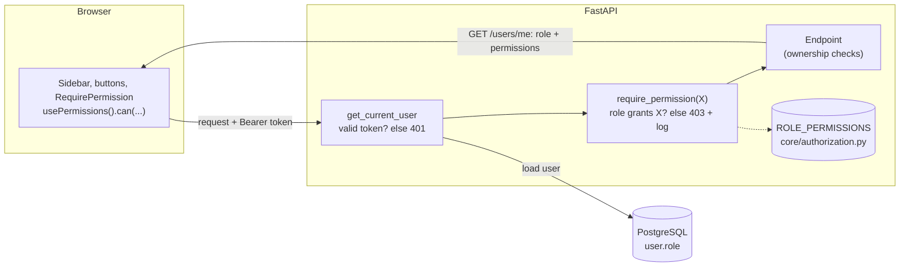

# Role-Aware Access on the Full-Stack FastAPI Template

Role-based access control (RBAC) added to the
[Full Stack FastAPI Template](https://github.com/fastapi/full-stack-fastapi-template)
(FastAPI, SQLModel, PostgreSQL, React, TypeScript).
The template's own documentation is kept in [TEMPLATE_README.md](./TEMPLATE_README.md);
scope cuts and trade-offs are in [NOTES.md](./NOTES.md).
The conversations with the AI tool used to build this are in
[docs/ai-conversations](./docs/ai-conversations/README.md).

## Run it locally

You only need Docker (with Docker Compose).

```bash
# 1. Start the database, the mail catcher and the app (API + built frontend)
docker compose up -d --build --wait db mailpit backend

# 2. Apply database migrations and seed the test users
docker compose exec backend bash scripts/prestart.sh
```

Open <http://localhost:8000> (API docs at <http://localhost:8000/docs>).

### Seeded test users

Step 2 creates one user per role. All use the password `changethis`
(`FIRST_SUPERUSER_PASSWORD` in [.env](./.env)).

| Email | Role |
|---|---|
| `admin@example.com` | admin |
| `manager@example.com` | manager |
| `member@example.com` | member |

The manager and member accounts are only created when `FASTAPI_ENV=development`
(the default in `.env`). The command is safe to run again; existing users are left alone.

### Run the tests

```bash
docker compose run --rm --no-deps -v ./backend:/app/backend backend bash scripts/tests-start.sh
```

The authorization tests are in
[backend/tests/api/routes/test_authorization.py](./backend/tests/api/routes/test_authorization.py).
The suite uses the development database and deletes all users when it finishes
(template behaviour), so run step 2 again afterwards to get the test users back.

End-to-end browser tests (Playwright), with the app from step 1 running:

```bash
docker compose run --rm --no-deps playwright bunx playwright test
```

The backend lint, type checks and tests also run on every pull request
([.github/workflows/test-backend.yml](./.github/workflows/test-backend.yml)).

### Database migrations

One migration was added:
[7b3f2c9d1a54_replace_is_superuser_with_role.py](./backend/app/alembic/versions/7b3f2c9d1a54_replace_is_superuser_with_role.py).
It adds `user.role`, turns existing superusers into admins and drops
`is_superuser`. It is applied by step 2 and can be rolled back with
`docker compose exec backend alembic downgrade -1`.

## Permission matrix

| Action | Permission | admin | manager | member |
|---|---|:-:|:-:|:-:|
| List users, view any user | `users:read` | ✓ | ✓ | ✗ |
| Create user | `users:create` | ✓ | ✗ | ✗ |
| Update any user, including their role | `users:update` | ✓ | ✗ | ✗ |
| Delete any user | `users:delete` | ✓ | ✗ | ✗ |
| View metrics | `metrics:read` | ✓ | ✓ | ✗ |
| See and manage everyone's items | `items:manage_all` | ✓ | ✗ | ✗ |
| Global settings (send test email, preview recovery email) | `settings:manage` | ✓ | ✗ | ✗ |
| View and update own profile, manage own items | none needed | ✓ | ✓ | ✓ |

New sign-ups are always members. Only someone with `users:update` can change a role.

## How authorization works

**One file defines the model.**
[backend/app/core/authorization.py](./backend/app/core/authorization.py) holds the
`Role` and `Permission` enums and `ROLE_PERMISSIONS`, the single map from role to
permissions. Endpoints never check a role; they ask for a permission. Adding a
role, or changing what a role may do, is an edit to that one map.

**Checks live in FastAPI dependencies.**
[backend/app/api/deps.py](./backend/app/api/deps.py) provides
`require_permission(Permission.X)`, which endpoints declare in their route
decorator, so the access rule is visible next to the URL. It builds on the
existing `get_current_user` dependency: a missing or invalid token gives `401`,
a valid user without the permission gives `403`, and every denial is logged with
user id, role and permission. Rules that depend on the data (for example "the
owner of this item, or anyone with `items:manage_all`") use the same
`has_permission` function inside the endpoint.

**Roles are stored on the user and read on every request.**
`user.role` is a text column (not a database enum type, so a new role needs no
schema change). The token only identifies the user; the role is loaded from the
database per request, so a role change takes effect immediately instead of when
the token expires. `role` is absent from the self-service schemas
(`UserRegister`, `UserUpdateMe`), which is what prevents self-promotion.

**The frontend asks the API what the user can do.**
`GET /users/me` returns the user's `permissions`. The
[usePermissions](./frontend/src/hooks/usePermissions.ts) hook exposes
`can("users:create")`; the sidebar filters its links with it, buttons are
rendered only when allowed, and
[RequirePermission](./frontend/src/components/Common/RequirePermission.tsx)
shows an "Access denied" page on direct navigation. The frontend contains no
role-to-permission logic, so it cannot drift from the backend. It is a
convenience only: the API enforces every rule regardless of what the UI shows.



Design decisions are recorded in [docs/adr](./docs/adr):

- [ADR 1: Permission-based checks with a central role map](./docs/adr/0001-permission-based-authorization.md)
- [ADR 2: The frontend gets capabilities from the API](./docs/adr/0002-frontend-capabilities-from-api.md)

## Adding a role

1. Add it to `Role` and give it permissions in `ROLE_PERMISSIONS`
   ([authorization.py](./backend/app/core/authorization.py)).
2. Regenerate the API client (`bash scripts/generate-client.sh`) and add its
   label in [frontend/src/lib/roles.ts](./frontend/src/lib/roles.ts); the
   TypeScript build fails until you do.

No endpoint, migration or UI guard needs to change.
